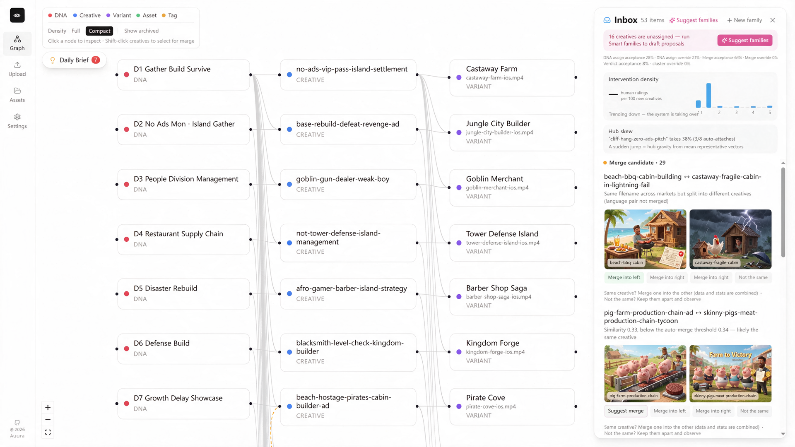

<div align="center">

<table align="center">
  <tr>
    <td><picture>
      <source media="(prefers-color-scheme: dark)" srcset="docs/assets/logo-dark.svg">
      <source media="(prefers-color-scheme: light)" srcset="docs/assets/logo-light.svg">
      
    </picture></td>
    <td><h1>Augura</h1></td>
  </tr>
</table>

**Ad creatives expire. The judgment behind them shouldn't.**

**Turn every creative review into reusable team memory.**<br>
Local-first creative intelligence for mobile-game UA teams.

[Quick Start](#quick-start) · [Watch the concept demo](#product-demo) · [简体中文](README.zh-CN.md)

[](https://github.com/augura-os/augura/actions/workflows/ci.yml) [](https://github.com/augura-os/augura/releases/latest) [](LICENSE) [](#data--privacy)

</div>

## Product demo

<p align="center">
  
</p>
<p align="center"><sub>Full 26-second concept demo · Synthetic data · <a href="https://auguraos.com/assets/augura-demo.mp4">Watch the real 26-second product demo →</a></sub></p>

<p align="center">
  
</p>
<p align="center"><sub>Actual product interface · Creative graph and human-review inbox.</sub></p>

> **Beta boundary**: Augura is a single-user local tool, with one project per instance. Docker Desktop is required. There is no auth or multi-tenancy, and all ports bind to `127.0.0.1` by default. **Do not expose it directly to the public internet**; team/server deployments need your own reverse proxy and authentication layer.

## Quick Start

**Prerequisite**: [Docker Desktop](https://www.docker.com/products/docker-desktop/).

**macOS / Linux** — one line, no clone needed:

```bash
curl -fsSL https://raw.githubusercontent.com/augura-os/augura/main/scripts/install.sh | bash
```

On macOS you can also download the repo and double-click `install.command`. On **Windows**, double-click `install.bat` from a checkout. All of them are idempotent — re-running updates and restarts.

Then open **http://localhost:3000**.

<details>
<summary>Manual Docker setup, local service URLs and network troubleshooting</summary>

```bash
cp .env.example .env
docker compose up -d          # release: pull prebuilt images from ghcr (~2-3 min)
docker compose up --build -d  # dev/private: build locally (first run ~20 min)
```

| Service | URL |
| --- | --- |
| Web (home = Creative Graph) | http://localhost:3000 |
| API | http://localhost:8000/docs |
| Neo4j Browser | http://localhost:7474 (random password generated on first install — see .env) |
| MinIO Console | http://localhost:9001 (same) |

The installer auto-falls-back from `raw.githubusercontent.com` to jsDelivr. When `ghcr.io` is unreachable, it pulls images via a mirror (`AUGURA_IMAGE_MIRROR`, default `ghcr.nju.edu.cn`). If Docker Hub is slow for the base images, configure `registry-mirrors` in Docker Desktop. For the Docker Desktop installer itself (~600 MB), a multi-connection downloader such as `aria2c` can help.

</details>

## How Augura helps

| Step | What you get |
| --- | --- |
| **Understand** | Turn each video into comparable creative elements such as hook, conflict, gameplay and reward. |
| **Connect** | Find related concepts and variants, then review proposed links in context. |
| **Remember** | Keep merge, split and iteration rulings available for future suggestions. |
| **Decide** | Get a Daily Brief with explainable recommendations and the numbers behind them. |

<details>
<summary>Detailed capabilities</summary>

- **AI creative analysis** — videos are frame-sampled and read by a vision model into structured JSON (hook / conflict / gameplay / reward / characters / emotion / tags). Low-confidence results route to human review — the AI never gets to guess silently.
- **Creative graph** — a five-layer knowledge graph (Neo4j) visualizes your entire creative world. Same filename with KS_EN and KS_KR market tags? The system spots two market versions of one creative and waits for your one-word ruling.
- **Merge guard** — pairs you once ruled "not the same creative" are remembered forever. Anyone trying to merge them must write down why. You make each judgment once — never twice.
- **Evolution tracking** — every variant records what it derived from and which factor changed (language / aspect ratio / intro sticker). When performance data flows back, you verdict the iteration; when a direction is exhausted, the system says so.
- **Review inbox** — merge candidates, unassigned creatives and observation-pair closures, each pre-adjudicated by LLM self-consistency votes with reasons attached. If the override rate crosses the line, auto-judging degrades to suggestion-only.
- **Explainable verdicts** — the Daily Brief's calls come from a registry of 18 named rules (`rules-v3`), each returning one of KEEP / ITERATE / PAUSE / ARCHIVE. Every suggestion carries a `reason_code` traceable to the exact named rule, a priority in dollars and a confidence score. This is decision support, not automatic media buying.
- **Data sovereignty** — creatives, performance rows and analyses live on your own machine / server / NAS in local data volumes. The Creative Genome Program uses documented allowlisted event fields and can be switched off in Settings.

</details>

## From installation to the first useful decision

### 1. Set your AI key

Open **Settings** and paste a key from any OpenAI-compatible provider. Nothing is called until you upload something. Self-hosted / local endpoints work too; with a local vision model, your frames never leave the machine.

<details>
<summary>Provider presets, local embeddings and configuration pitfalls</summary>

| Key source | Base URL | Vision model | Embedding |
| --- | --- | --- | --- |
| OpenAI | `https://api.openai.com/v1` | `gpt-4o` | `text-embedding-3-small` |
| Kimi Open Platform (platform.moonshot.cn) | `https://api.moonshot.cn/v1` | `kimi-k2.5` | `BAAI/bge-small-zh-v1.5` (built-in local) |
| Kimi Coding Plan (kimi.com, `sk-kimi-…` keys) | `https://api.kimi.com/coding/v1` | `kimi-for-coding` | `BAAI/bge-small-zh-v1.5` (built-in local) |

The built-in local embedding model downloads once on first use (~95 MB) and works offline afterwards; if unavailable, recall falls back to local text similarity.

The two kinds of Kimi keys are **not interchangeable** — a `sk-kimi-` coding-plan key returns 401 on `api.moonshot.cn`, and vice versa. A Base URL missing its `/v1` path fails analysis with a 404; Settings warns before saving such a URL.

</details>

### 2. Upload a batch

Drag mp4 / png / xlsx (Facebook exports) into **Upload**. Each video takes a few minutes to analyze; the graph grows as results arrive.

### 3. Review the suggestions

Open the **inbox**: merge candidates, unassigned creatives and observation-pair closures arrive with suggestions and reasons. Merge, split or assign — the human ruling is saved.

### 4. Feed performance back

Upload the week's delivery Excel. Spend, payers and ROAS match back to creatives, and the **Daily Brief** turns them into reviewable next actions with the numbers behind every call.

<details>
<summary>Running multiple projects</summary>

One Augura instance = one project. To manage multiple games/projects, run a separate instance per project with fully isolated data:

```bash
git clone <repo> augura-game-a
git clone <repo> augura-game-b
```

In `augura-game-b/`, add a `docker-compose.override.yml` to shift the host ports. Container-to-container traffic uses the internal network and is unaffected. `!override` replaces the port list wholesale and requires Docker Compose v2.24+:

```yaml
services:
  postgres:
    ports: !override
      - "127.0.0.1:5434:5432"
  neo4j:
    ports: !override
      - "127.0.0.1:7475:7474"
      - "127.0.0.1:7688:7687"
  minio:
    ports: !override
      - "127.0.0.1:9002:9000"
      - "127.0.0.1:9003:9001"
  api:
    ports: !override
      - "127.0.0.1:8001:8000"
  web:
    ports: !override
      - "127.0.0.1:3001:80"
```

Run `docker compose up -d` in each directory; project B lives at http://localhost:3001. AI keys and market prefixes are configured per instance. Each instance runs its own Postgres/Neo4j/MinIO, so memory usage scales with the number of instances. Single-instance multi-project support is on the roadmap; the schema already reserves `project_id`.

</details>

## Data & Privacy

See [PRIVACY.md](PRIVACY.md) for the full policy. Data follows three separate paths:

- **Project data** stays in the local data volumes by default.
- **AI analysis** sends sampled frames and structured results to the model endpoint you configure in Settings. A local endpoint can keep those requests on your machine.
- **Telemetry** is not transmitted by a default self-hosted install because `TELEMETRY_ENDPOINT` is empty. If you configure an endpoint, the Creative Genome Program is enabled by default and can be turned off in Settings; operational error/version events remain enabled while the endpoint is configured. See the [telemetry field allowlist](apps/api/telemetry/allowlist.py).

## Architecture

```
┌──────────────┐     ┌──────────────┐     ┌──────────────────┐
│  React Web   │────>│  FastAPI     │────>│   PostgreSQL     │
│ (graph/inbox)│<────│ (rule engine)│<────│ (structured data)│
└──────────────┘     └──────┬───────┘     └──────────────────┘
                            │
              ┌─────────────┼─────────────┐
              │             │             │
        ┌─────┴─────┐ ┌─────┴─────┐ ┌─────┴────────┐
        │   Neo4j   │ │   MinIO   │ │ LLM provider │
        │  (graph)  │ │  (files)  │ │(analysis/    │
        └───────────┘ └───────────┘ │  judging)    │
                                    └──────────────┘
```

| Layer | Stack |
| --- | --- |
| Frontend | React + TypeScript + Vite + React Flow |
| Backend | FastAPI + SQLAlchemy + Alembic (Python 3.12) |
| Storage | PostgreSQL 16 · Neo4j 5 · MinIO |
| AI | Any OpenAI-compatible endpoint; vision-model analysis + self-consistency judging |

## Development & Contributing

See [CONTRIBUTING.md](CONTRIBUTING.md) for the trunk-based workflow, PR requirements and release process.

```bash
cd apps/web && npm install && npm run dev
cd apps/api && pytest
```

For the offline merge-family evaluation harness and its privacy/test protocol, see [docs/merge-family-experiment.md](docs/merge-family-experiment.md). Questions, bugs and workflow proposals are welcome in [GitHub Issues](https://github.com/augura-os/augura/issues).

If Augura earns your trust, a [star](https://github.com/augura-os/augura) helps other UA and creative teams discover it.

## Why "Augura"?

Design production has Figma. Code production has Git. Media buying has the ad platforms. But *how a creative actually evolves* — that process never had a system of record.

Augura aims to be the operating system for creative production: creatives are processes, the graph is the file system, and every human ruling is experience written into the kernel. One buyer's judgment is finite; a team that accumulates isn't.

## License

[Modified Apache 2.0](LICENSE) (Apache 2.0 incorporated + additional terms), attribution in [NOTICE](NOTICE):

- Normal use, modification and internal deployment: fully free.
- Offering the software as a hosted service / SaaS to third parties requires a commercial license.
- Don't remove the logo or copyright notices from the UI; backend-only usage is exempt.
