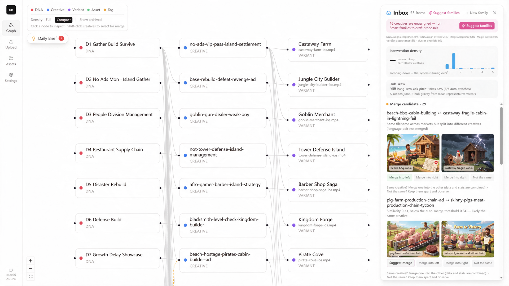

<div align="center">

<table align="center">
  <tr>
    <td><picture>
      <source media="(prefers-color-scheme: dark)" srcset="docs/assets/logo-dark.svg">
      <source media="(prefers-color-scheme: light)" srcset="docs/assets/logo-light.svg">
      
    </picture></td>
    <td><h1>Augura</h1></td>
  </tr>
</table>

**素材会过时，做素材的经验不该过时。**

**把每次创意复盘沉淀为团队可复用的经验。**<br>
面向手游 UA 团队的本地创意智能系统。

[快速安装](#快速安装) · [观看概念演示](#概念演示) · [English](README.md)

[](https://github.com/augura-os/augura/actions/workflows/ci.yml) [](https://github.com/augura-os/augura/releases/latest) [](LICENSE) [](#数据与隐私)

</div>

## 概念演示

<p align="center">
  
</p>
<p align="center"><sub>完整 26 秒概念演示 · 合成数据 · <a href="https://auguraos.com/assets/augura-demo.mp4">观看真实 26 秒产品视频 →</a></sub></p>

<p align="center">
  
</p>
<p align="center"><sub>真实产品界面 · 创意图谱与人工审核收件箱。</sub></p>

> **Beta 边界**：Augura 是单用户本地工具，一个实例对应一个项目，需要 Docker Desktop。没有登录认证或多租户，所有端口默认只绑定 `127.0.0.1`。**不要直接部署到公网**；团队或服务器部署需要自行配置反向代理与认证层。

## 快速安装

**前置要求**：[Docker Desktop](https://www.docker.com/products/docker-desktop/)。

**macOS / Linux**——一行命令，无需下载仓库：

```bash
curl -fsSL https://raw.githubusercontent.com/augura-os/augura/main/scripts/install.sh | bash
```

macOS 也可以下载仓库后双击 `install.command`；**Windows** 在仓库目录中双击 `install.bat`。三者都幂等——重复运行即更新重启。

安装完成后打开 **http://localhost:3000**。

<details>
<summary>手动 Docker 安装、本地服务地址与网络故障处理</summary>

```bash
cp .env.example .env
docker compose up -d          # 发布版：直接拉取 ghcr 预构建镜像（约 2-3 分钟）
docker compose up --build -d  # 开发/私有部署：本地构建（首次约 20 分钟）
```

| 服务 | 地址 |
| --- | --- |
| Web（首页 = 创意图谱） | http://localhost:3000 |
| API | http://localhost:8000/docs |
| Neo4j Browser | http://localhost:7474（首次安装向导会生成随机密码，见 .env） |
| MinIO Console | http://localhost:9001（同上） |

安装脚本会自动从 `raw.githubusercontent.com` 回退到 jsDelivr；`ghcr.io` 不通时，会通过镜像站拉取镜像（`AUGURA_IMAGE_MIRROR`，默认 `ghcr.nju.edu.cn`）。如果 Docker Hub 基础镜像下载较慢，可在 Docker Desktop 中配置 `registry-mirrors`。Docker Desktop 安装包本身约 600 MB，可使用 `aria2c` 等多线程下载工具。

</details>

## Augura 如何帮助团队

| 环节 | 团队得到什么 |
| --- | --- |
| **Understand** | 把视频拆成可比较的创意元素，例如钩子、冲突、玩法与奖励。 |
| **Connect** | 找到相关创意与变体，并在上下文中审核系统提出的关联。 |
| **Remember** | 记住合并、拆分和迭代裁决，让后续建议能参考过去的判断。 |
| **Decide** | 通过 Daily Brief 查看可解释建议，以及结论背后的数据。 |

<details>
<summary>查看详细能力</summary>

- **AI 素材解析** — 视频抽帧后由视觉模型输出结构化 JSON（钩子/冲突/玩法/奖励/角色/情绪/标签）。分析没把握的自动进入人工复核，不让 AI 硬猜。
- **创意图谱** — 五层知识图谱（Neo4j）可视化整个素材世界。KS_EN 和 KS_KR 的同名文件？系统会认出同一素材的两个市场版本，等待人工裁决。
- **合并守卫** — 你裁过“这俩不是同一个创意”的组合会被永久记住。再次尝试合并时必须写明理由，判断只做一次。
- **裂变演化** — 每条 Variant 记录来源及变化因子（换语言/换画幅/换前贴等）。投放数据回流后可判定迭代是否有效；方向耗尽时，系统会给出停止建议。
- **审核收件箱** — 疑似合并、未归族、观察对结案，每类都先由 LLM 自洽投票给出建议和理由。改判率越线后，自动判定会降级为仅建议模式。
- **可解释判定** — 今日建议的每条结论都出自 18 条具名规则组成的注册表（`rules-v3`），判定结果四态：KEEP / ITERATE / PAUSE / ARCHIVE。每条建议带 `reason_code`、金额优先级和置信度。它提供决策支持，不会自动执行投放。
- **数据主权** — 素材、投放明细和分析结果保存在你自己的电脑、服务器或 NAS 本地数据卷中。创意基因共建计划使用文档列出的遥测字段白名单，可在 Settings 关闭。

</details>

## 从安装到第一次有效决策

### 1. 配置 AI Key

打开 **Settings**，填入任一 OpenAI 兼容接口的 Key。不上传素材不会产生任何调用。也支持自建或本地端点；使用本地视觉模型时，抽帧画面不会离开本机。

<details>
<summary>模型服务预设、本地向量模型与常见配置问题</summary>

| Key 来源 | Base URL | 视觉模型 | Embedding |
| --- | --- | --- | --- |
| OpenAI | `https://api.openai.com/v1` | `gpt-4o` | `text-embedding-3-small` |
| Kimi 开放平台（platform.moonshot.cn） | `https://api.moonshot.cn/v1` | `kimi-k2.5` | `BAAI/bge-small-zh-v1.5`（内置本地） |
| Kimi Coding Plan（kimi.com，`sk-kimi-…` Key） | `https://api.kimi.com/coding/v1` | `kimi-for-coding` | `BAAI/bge-small-zh-v1.5`（内置本地） |

内置本地向量模型首次使用时会下载一次（约 95 MB），之后可离线工作；如果不可用，召回会回退到本地文本相似度。

两种 Kimi Key **不能混用**：`sk-kimi-` Coding Plan Key 在 `api.moonshot.cn` 会返回 401，反之亦然。Base URL 缺少 `/v1` 会导致分析请求返回 404；Settings 会在保存此类地址前发出警告。

</details>

### 2. 上传一批素材

在 **Upload** 页拖入 mp4 / png / xlsx（Facebook 报表）。每条视频需要几分钟分析，图谱会随结果返回逐渐生成。

### 3. 审核系统建议

打开**收件箱**：疑似合并、未归族和观察对结案都带有建议与理由。合并、拆分或归族后，人工裁决会被保存。

### 4. 回流投放数据

上传每周投放 Excel，消耗、付费和 ROAS 会匹配回素材。**今日建议**会生成可供复核的下一步行动，并附上结论背后的数据。

<details>
<summary>运行多个项目</summary>

一个 Augura 实例对应一个项目。要管理多个游戏或项目，请为每个项目运行一套独立实例，数据完全隔离：

```bash
git clone <repo> augura-game-a
git clone <repo> augura-game-b
```

在 `augura-game-b/` 中新建 `docker-compose.override.yml`，错开宿主端口。容器间通信使用内部网络，不受影响。`!override` 会整体替换端口列表，需要 Docker Compose v2.24+：

```yaml
services:
  postgres:
    ports: !override
      - "127.0.0.1:5434:5432"
  neo4j:
    ports: !override
      - "127.0.0.1:7475:7474"
      - "127.0.0.1:7688:7687"
  minio:
    ports: !override
      - "127.0.0.1:9002:9000"
      - "127.0.0.1:9003:9001"
  api:
    ports: !override
      - "127.0.0.1:8001:8000"
  web:
    ports: !override
      - "127.0.0.1:3001:80"
```

两套各自执行 `docker compose up -d`，项目 B 访问 http://localhost:3001。AI Key 和市场前缀按实例配置。每套实例都会运行独立的 Postgres/Neo4j/MinIO，内存占用随实例数增加。单实例多项目支持已在路线图中，schema 已预留 `project_id`。

</details>

## 数据与隐私

完整说明见 [PRIVACY.md](PRIVACY.md)。数据分为三条路径：

- **项目数据**默认保存在本地数据卷中。
- **AI 分析**会把抽帧画面和结构化结果发送至你在 Settings 配置的模型服务；使用本地模型端点可让这些请求留在本机。
- **遥测**在默认自建安装中不会外发，因为 `TELEMETRY_ENDPOINT` 为空。配置端点后，创意基因共建计划默认开启，可在 Settings 关闭；端点配置期间，运行保障的错误与版本事件会保持开启。允许发送的字段见[遥测字段白名单](apps/api/telemetry/allowlist.py)。

## 架构

```
┌──────────────┐     ┌──────────────┐     ┌──────────────────┐
│  React Web   │────>│  FastAPI     │────>│   PostgreSQL     │
│  (图谱/收件箱)│<────│ (规则引擎)   │<────│ (结构化数据)    │
└──────────────┘     └──────┬───────┘     └──────────────────┘
                            │
              ┌─────────────┼─────────────┐
              │             │             │
        ┌─────┴─────┐ ┌─────┴─────┐ ┌─────┴────────┐
        │   Neo4j   │ │   MinIO   │ │ LLM 提供方   │
        │  (图谱)   │ │ (素材文件)│ │(分析/判定)   │
        └───────────┘ └───────────┘ └──────────────┘
```

| 层级 | 技术栈 |
| --- | --- |
| 前端 | React + TypeScript + Vite + React Flow |
| 后端 | FastAPI + SQLAlchemy + Alembic（Python 3.12） |
| 存储 | PostgreSQL 16 · Neo4j 5 · MinIO |
| AI | 任意 OpenAI 兼容接口；视觉模型分析 + 自洽投票判定 |

## 开发与贡献

参与贡献请参阅[贡献指南](CONTRIBUTING.md)，其中包含 trunk-based 工作流、PR 要求与发布流程。

```bash
cd apps/web && npm install && npm run dev
cd apps/api && pytest
```

离线归族实验及隐私/协作测试协议见 [docs/merge-family-experiment.md](docs/merge-family-experiment.md)。欢迎在 [GitHub Issues](https://github.com/augura-os/augura/issues) 提出问题、反馈 Bug 或讨论创意工作流。

如果 Augura 对你有帮助，一个 [Star](https://github.com/augura-os/augura) 能让更多 UA 与创意团队发现它。

## 为什么叫 "Augura"？

设计的生产有 Figma，代码的生产有 Git，投放的执行有广告后台——但“创意是怎么一步步迭代出来的”这件事，从来没有过自己的系统。

Augura 想做创意生产的操作系统：素材是进程，图谱是文件系统，而每一次人工裁决都是写进内核的经验。单个优化师的判断力是有限的，但一个会积累的团队不是。

## 开源协议

[Modified Apache 2.0](LICENSE)（Apache 2.0 全文并入 + 附加条件），署名信息见 [NOTICE](NOTICE)：

- 正常使用、二次开发、企业内部部署，完全自由。
- 拿本软件向第三方提供托管服务 / SaaS，需取得商业授权。
- 不得移除界面中的 LOGO 与版权信息；不使用界面的用法（只跑后端）不受此限。
